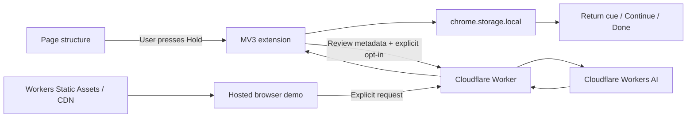

# Hold My Place

A private browser memory aid for interrupted online tasks. Save where you were and return to one clear next step.

**[Live demo](https://hold-my-place.aiconic-innovations.workers.dev)** · **[Install extension](https://hold-my-place.aiconic-innovations.workers.dev/install)** · **[Recorded demo](https://hold-my-place.aiconic-innovations.workers.dev/watch)** · **[Pitch deck](https://hold-my-place.aiconic-innovations.workers.dev/pitch)** · **[Privacy](https://hold-my-place.aiconic-innovations.workers.dev/privacy)**

Built for [IEEE Hack for Humanity](https://ieee-ai-hack-for-humanity.devpost.com/), Track 2: AI for Accessibility and Disability Inclusion.

Solo contributor: Naveen Chatlapalli. [Public source repository](https://github.com/1aifanatic/hold-my-place). [Submission copy](submission/DEVPOST.md).

## Try it

1. On the live demo, enter fictional details and progress to the photo step.
2. Choose **Hold my place**, **Take a pretend break**, then **I'm back**.
3. Choose **Continue**: the next incomplete field receives focus and a highlight.
4. Inspect the capture: labels and fill-state booleans, never typed answers.
5. Edit a note, try an optional AI cue, or forget everything.

For use on other websites, download the ZIP, extract it, enable developer mode at `chrome://extensions` or `edge://extensions`, and load the folder containing manifest.json. Reload existing tabs. Press **Alt+H**, or use the toolbar popup. Configure shortcut conflicts at `chrome://extensions/shortcuts`.

## Small architecture



Plain HTML/CSS/JavaScript. No frontend framework, runtime package, account system, database or telemetry. Cloudflare provides Workers, Static Assets/CDN, Workers AI and a rate-limit binding. Adding every Cloudflare service would contradict the local-only privacy goal and increase complexity; D1, KV, R2 and Queues are intentionally unnecessary for this product. The demo video is a static public artifact, not a user capture.

Default cues run locally and offline. Optional AI uses `@cf/meta/llama-3.3-70b-instruct-fp8-fast` with JSON mode, a bounded metadata payload, a 20-word cue check and local fallback. The endpoint has a 10 requests/minute/IP rate limit. No captured data is persisted by the Worker. Cloudflare processes AI inputs and network metadata under its own policies.

## Privacy and safety

- Capture happens only on a user action. No field values, passwords, screenshots, cookies or keystroke history are stored.
- URL, title, headings, labels, fill flags, focus, scroll and optional note are local. Metadata itself can be sensitive.
- AI is disabled by default in the extension. Even after enabling it, each request requires an explicit button press; its exact JSON preview is visible first.
- Keyword checks block likely sensitive sites. They are best effort, not a privacy classifier guarantee.
- A focused Submit/Pay action produces a check-first cue; the extension never submits, autofills or restores answers.
- Default expiry is 24 hours, with 1-hour and 7-day options. Expired places are removed on access and by an alarm while Chrome runs. Forget everything clears places, correction counts and settings.
- Browser speech is optional. Offline availability depends on the selected OS/browser voice.

## Development and checks

```sh
npm ci
npm test
npx wrangler dev --port 8794 --inspector-port 9238
# In another shell, set BASE_URL to http://127.0.0.1:8794
node scripts/browser-check.mjs
npm run package
npm run deploy
```

The package script copies the shared cue policy into the demo and builds the extension ZIP. Run it after editing extension files. `scripts/browser-check.mjs` launches an actual unpacked MV3 extension with Playwright Chromium. It verifies saved metadata excludes known typed values, banner focus, notes, wiping and responsive demo behavior. Tests are engineering checks, not evidence of improved accessibility outcomes. Screenshots and the last browser-check receipt are in `artifacts/`.

## Research basis

- [W3C cognitive accessibility: Help Users Focus](https://www.w3.org/WAI/WCAG2/supplemental/objectives/o5-user-focus/) recommends interfaces that support focus and avoid distraction. This informs the short cue and user control.
- [Monk, Trafton and Boehm-Davis: effect of interruption duration and demand on resuming suspended goals](https://pubmed.ncbi.nlm.nih.gov/19102614/) reports that interruption duration and demand affect task resumption. This motivates measuring time to resume rather than claiming generic productivity gains.
- [NIMH: ADHD in Adults](https://www.nimh.nih.gov/health/publications/adhd-what-you-need-to-know) describes challenges with attention, staying on task and organization. It supports the user-need framing, not efficacy of this prototype.

No interviews, participant study or measured improvement claims are presented. At the owner's request, [a clearly labeled synthetic dataset](https://hold-my-place.aiconic-innovations.workers.dev/evaluation) illustrates the evaluation method; it contains invented scenarios, not human observations. No broad checkout abandonment statistic is substituted for evidence about people with cognitive disabilities. See `submission/STUDY.md` for the recruitment, consent, counterbalanced protocol and raw results template. Two practice variants are available: [licence renewal](https://hold-my-place.aiconic-innovations.workers.dev/#demo) and [library membership](https://hold-my-place.aiconic-innovations.workers.dev/?task=library#demo).

## Scope and limitations

F1–F7 are implemented for ordinary top-level HTTP(S) pages. F8 typed notes, F9 speech output and F10 configurable expiry are implemented. F11 continuous voice trigger and F12 automatic interruption suggestions are optional PRD features and are not implemented. Dictation can use operating-system dictation; there is no built-in voice recognition. The extension does not cover browser settings pages, store pages, PDF viewers, cross-origin frames or arbitrary closed shadow roots. Changing forms may invalidate field indices; Continue verifies the saved label and otherwise restores scroll. Some unlabelled controls get generic labels. Firefox is outside this build.

Controls are keyboard reachable, the return cue has an ARIA live region, focus is visible, and the banner has no animation. Automated and browser checks do not establish full WCAG conformance or screen-reader compatibility across platforms. Participant testing and a manual assistive-technology audit remain required before making those claims.

## Credits and AI disclosure

Product owner: Naveen Chatlapalli. OpenAI Codex assisted implementation, testing, documentation and recording automation. Cloudflare Workers AI provides optional inference using Meta Llama 3.3. MiniMax speech-2.8-hd generated the demo narration using the owner's existing voice clone; no new voice was cloned. The recording uses fictional form data, Playwright and FFmpeg. Major dependencies and licenses are in `package-lock.json`; no third-party visual assets or music are used. The narration helper reuses the API request pattern from the owner's earlier CareProof demo tooling; all product code here was created for Hold My Place.
